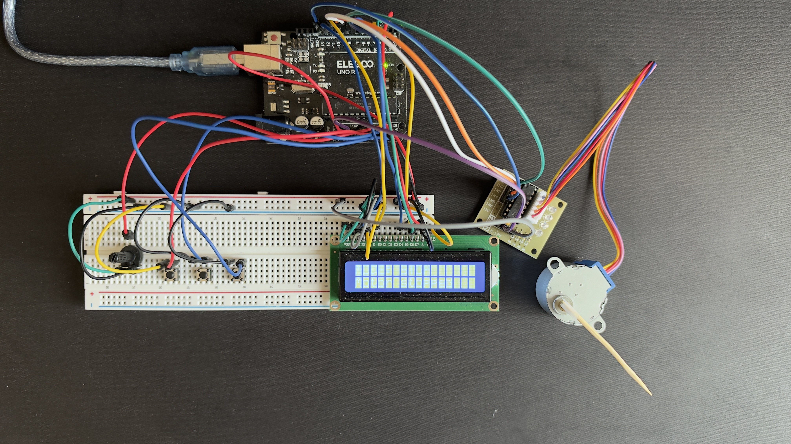
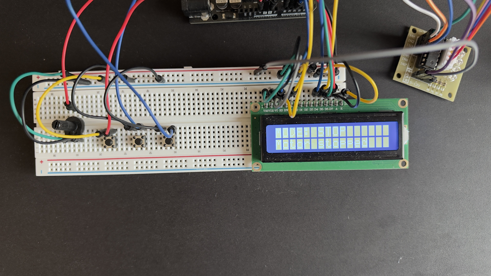
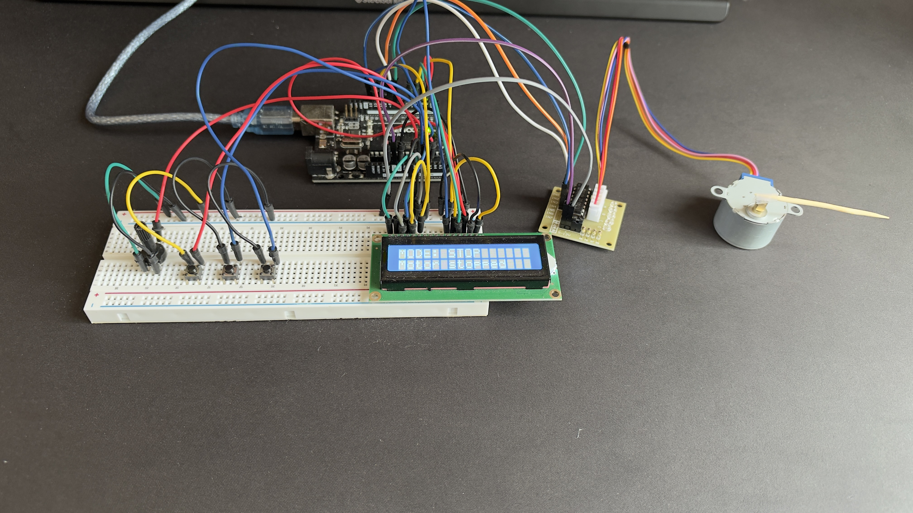

# Smart Stepper Motor Controller

An Arduino-based stepper motor control system featuring multiple operating modes, real-time monitoring through a Python desktop application, serial communication, and automated software tests.

## Project Overview

This project demonstrates the integration of embedded hardware and desktop software to control and monitor a stepper motor.

The system uses an Arduino Uno R3 to control a 28BYJ-48 stepper motor through a ULN2003 driver. A 16×2 LCD displays operating information, while a Python application provides real-time monitoring and CSV data logging.

## Features

- **Manual Mode:** Adjust the commanded motor speed from 2 to 12 RPM using a potentiometer.
- **Automatic Mode:** Operate at a commanded speed of 6 RPM, automatically reversing direction after each programmed revolution.
- **Stop Mode:** Stop issuing motor step commands.
- **LCD Display:** Display the operating mode, commanded speed, and direction.
- **Python Dashboard:** Monitor motor commands and operating states in real time.
- **CSV Data Logging:** Export timestamped operating data.
- **Data Validation:** Validate incoming serial messages before processing.
- **Automated Testing:** Eight unit tests covering valid and invalid serial messages.

## Hardware Components

| Component                   | Purpose                       |
| ----------------------------| ------------------------------|
| Arduino Uno R3              | Main microcontroller          |
| 28BYJ-48 stepper motor      | Motor actuator                |
| ULN2003 driver              | Stepper motor driver          |
| LCD1602                     | Local information display     |
| Potentiometer               | Manual speed adjustment       |
| Three push buttons          | Mode selection                |
| Breadboard and jumper wires | Circuit connections           |

## Technologies Used

**Embedded Systems**
- Arduino
- C/C++
- Stepper and LiquidCrystal libraries

**Desktop Software**
- Python
- Tkinter
- PySerial
- CSV data logging

**Development and Testing**
- Git
- Python unittest
- Visual Studio Code
- Arduino IDE

## Project Structure

```text
Smart Stepper Motor Control/
├── arduino/
│   └── SmartStepperMotorControl_ArduinoCode/
│       └── SmartStepperMotorControl_ArduinoCode.ino
├── python/
│   ├── dashboard.py
│   ├── motor_protocol.py
│   ├── read_serial.py
│   └── requirements.txt
├── tests/
│   ├── check_serial_ports.py
│   └── test_motor_data.py
├── .gitignore
└── README.md
```
## Electrical Schematic

The electrical schematic was designed using **KiCad** and checked using the Electrical Rules Checker (ERC), with 0 errors and 0 warnings.

The schematic documents the Arduino UNO R3, ULN2003A motor driver, 28BYJ-48 stepper motor connector, LCD1602 display, potentiometer, and push-button controls.

**Documentation:**
- [View Electrical Schematic (PDF)](docs/Smart_Stepper_Motor_Schematic.pdf)
- [View KiCad Project](docs/Smart_Stepper_Motor_Schematic/)

## Hardware Prototype

The prototype was assembled using an Arduino UNO R3, a 28BYJ-48 stepper motor, a ULN2003 driver module, an LCD1602 display, three push buttons, and a potentiometer.

## Hardware Prototype

The prototype was assembled using an Arduino UNO R3, a 28BYJ-48 stepper motor, a ULN2003 driver module, an LCD1602 display, three push buttons, and a potentiometer.

### Complete Hardware Setup



### Circuit Details



### Additional View



## Installation

1. Clone or download this repository.
2. Install the Python dependency:

```bash
python -m pip install -r python/requirements.txt
```

3. Connect the Arduino Uno to the computer.
4. Upload the Arduino sketch using Arduino IDE.
5. Update the serial port configuration in `python/dashboard.py` if necessary.
6. Run the dashboard from the project root:

```bash
python python/dashboard.py
```

## Automated Tests

Run the unit tests from the project root:

```bash
python -m unittest discover -s tests -p "test_*.py" -v
```

Current test coverage includes message formatting, operating modes, speed limits, and direction validation.

**Result:** 8 tests passed.

## Serial Communication

The Arduino sends structured messages to the Python application.

Example:

```text
DATA,MANUAL,8,R
DATA,AUTOMATIC,6,L
DATA,STOP,0,-
```

Format:

`DATA,MODE,SPEED,DIRECTION`

The reported speed is the commanded motor speed, not an independently measured RPM value.

## Future Improvements

- Real-time speed visualization
- Additional automated integration tests
- GitHub Actions continuous integration
- Circuit schematic and hardware documentation
- Demonstration video and project photographs

## Author

Anass Ait Yakoub

Electrical Engineering Student — Concordia University

Expected Graduation: 2029